

# [DirectX11] 소환사의 협곡 (League of Legends) 모작

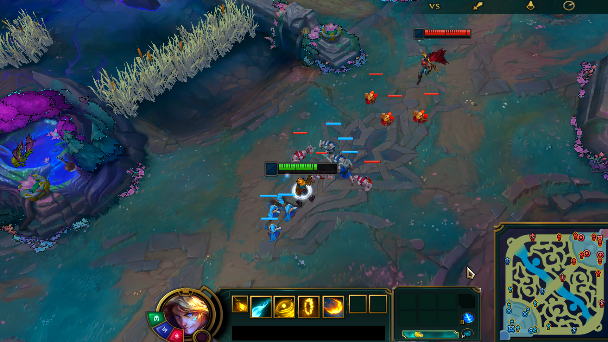

개발기간 : 2025.11.10 ~ 2026.01.15 (약 2개월)

개발인원 : 1명 (개인 프로젝트)

##### 📌 엔진부터 게임, 에디터 툴, 에셋 변환 파이프라인까지 혼자 설계하고 구현했습니다.

  

# *동영상/GitHub*

[소환사의 협곡 모작 시연 영상](https://youtu.be/F_ivCejGjnE) | [Notion 포트폴리오](https://www.notion.so/2f80c02b964a8187b5fad501b2988d87)

# *구현 내용*

- ***프레임워크 (자체 엔진)***
- ***플레이어 / 적 AI / 미니언 / 건물 (전투 컨텐츠)***
- ***쉐이더, 빛 연산 (디퍼드, 그림자, 외곽선, 글로우, 디스토션)***
- ***네비게이션 (A\* + Funnel)***
- ***ImGui 에디터 툴, FBX 변환 파이프라인***

### 프로젝트 구성

| 프로젝트 | 설명 |
|---|---|
| **Engine** (`Engine.dll`) | 렌더러, 오브젝트·레벨 매니저, 모델·애니메이션, 내비게이션, 사운드, 입력 |
| **Client** (`Client.exe`) | 챔피언, 적 AI, 미니언, 건물, UI, 이펙트 |
| **Tool** (`ImGui/`) | 지형·모델·내비메시·이펙트·애니메이션 에디터 |
| **FbxToDat** | FBX/GLB 에셋을 전용 `.dat` 바이너리로 변환 |

개발 환경 : Visual Studio 2022 / Windows / x64 &nbsp;|&nbsp; 사용 기술 : `C++` `DirectX 11` `HLSL` `Assimp` `FMOD` `DirectXTK` `Effects11` `ImGui`

# *게임 주요 사진*

해당 게임은 챔피언을 조종해 미니언 웨이브와 함께 라인을 밀고, 터렛과 억제기를 파괴해 **적 넥서스를 부수면 승리**하는 MOBA 게임입니다.

### 플레이 가능 챔피언

플레이어는 **이즈리얼, 티모, 리신** 3종을 `F4`로 실행 중에 교체하며 조종할 수 있습니다.

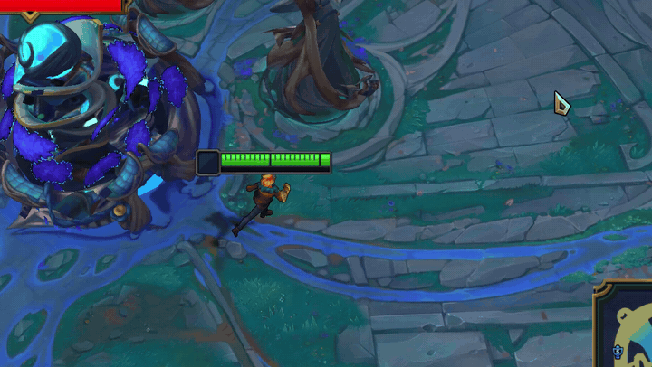 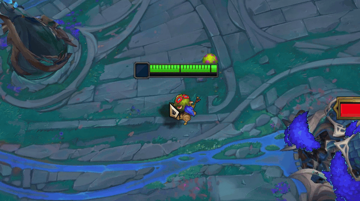 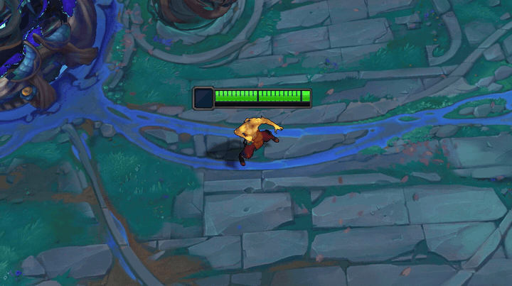

### 맵 구성

맵은 탑·미드·바텀 3개 라인과 양 팀(블루/레드)의 기지(넥서스, 억제기, 터렛)로 구성되어 있습니다.

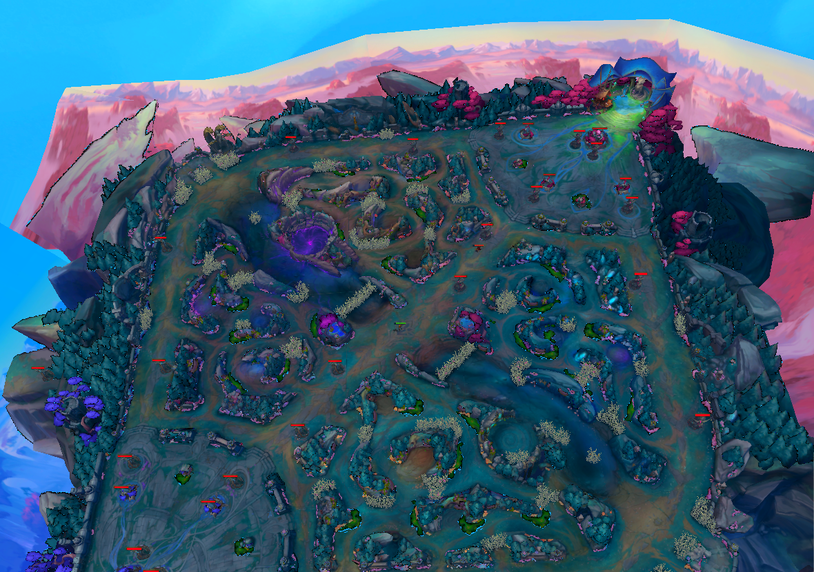

### 조작법

| 입력 | 동작 |
|---|---|
| 마우스 우클릭 | 이동 / 공격 |
| `Q` `W` `E` `R` | 스킬 |
| `A` | 공격 사거리 표시 토글 |
| `B` (누르고 유지) | 귀환 |
| `Ctrl` + `1` `2` `3` | 감정표현 |
| `1` | 미니언 웨이브 소환 |
| `F4` | 플레이어 챔피언 교체 |
| 마우스 휠 | 카메라 줌 |
| `F1` | 디버그 카메라 전환 |

# *컨텐츠 및 기능 설명*

## 1. 플레이어

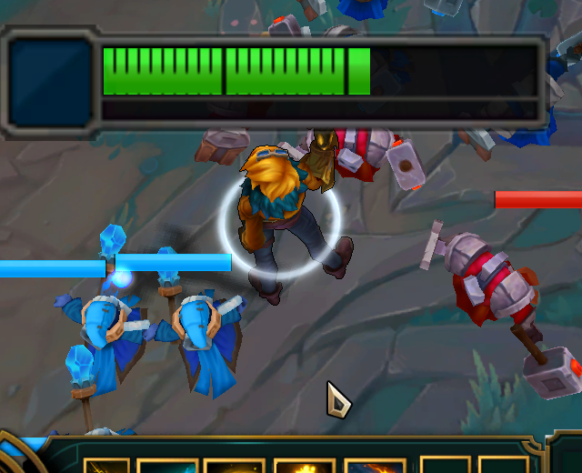 

플레이어 챔피언은 3종(이즈리얼, 리신, 티모)이며 `F4`로 실행 중에 교체할 수 있습니다. 모든 동작은 **상태(State) 패턴**으로 분리했습니다.

- **상태:** 대기, 이동, 평타, 스킬(Q/W/E/R), 귀환, 감정표현, 사망/부활을 각각 상태 클래스로 두었습니다. 챔피언별로 다른 부분(재시전, 표식 등)은 챔피언 전용 상태가 처리합니다.
- **이동:** 우클릭한 지점까지 **내비메시 경로(A\* + Funnel)** 를 따라 이동합니다.
- **공격:** 적을 우클릭하면 사거리 안에 들어올 때까지 접근한 뒤 공격합니다. 마우스를 올린 대상에 따라 커서가 공격 커서로 바뀌고, `A`로 공격 사거리를 표시할 수 있습니다.
- **귀환:** `B`를 누르고 있는 동안 귀환 이펙트와 진행 사운드가 재생되고, 끝까지 유지하면 완료음과 함께 부활 지점으로 이동합니다. 도중에 우클릭으로 이동하면 취소되며 사운드와 이펙트가 정리됩니다.
- **사망 / 부활:** 사망하면 충돌 그룹에서 빠져 AI가 타겟으로 잡지 못하고, 일정 시간 뒤 체력을 모두 회복하며 스폰 애니메이션과 함께 부활합니다.
- **감정표현:** `Ctrl + 1/2/3`으로 챔피언별 감정표현 애니메이션과 음성을 재생합니다. 다른 감정표현을 누르면 즉시 교체됩니다.
- **스탯:** 레벨당 성장(체력, 마나, 공격력, 공격속도, 방어력, 재생)을 지원하고, 경험치바와 스킬 쿨타임 UI가 연동됩니다.
- **버프 / 상태이상:** 이동속도 버프(이펙트가 캐릭터를 따라다님), 지속 피해(독), 실명, 대상에 남는 표식을 공통 기반(`Actor`)에서 처리해 챔피언과 미니언이 함께 사용합니다.

## 2. 적 챔피언 AI

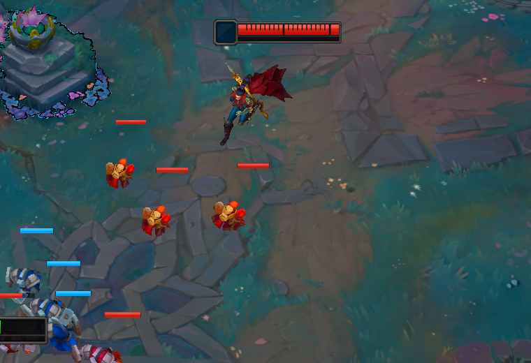

적 챔피언 3종(베인, 레넥톤, 레오나)이 라인을 따라 이동하며 플레이어와 교전합니다.

- **라인 이동:** 대상이 없을 때는 라인 좌표 데이터를 따라 다음 노드로 이동하고, 추격 후에 다시 라인으로 돌아올 때는 가장 가까운 노드를 기준으로 경로를 보정합니다.
- **타겟 선택:** 챔피언 → 가장 가까운 미니언 → 건물 순으로 우선순위를 두고, 이미 정한 타겟이 유효하면 유지합니다. 조종 중이 아닌 챔피언이나 죽은 챔피언은 타겟에서 제외합니다.
- **포탑 공격 조건:** 아군 미니언이 포탑 근처에 있을 때만 건물을 공격하도록 제한했습니다. (포탑 다이브 방지)
- **추적 / 포기:** 어그로 / 추적 / 포기 거리를 가지고, 타겟을 잃으면 원래 위치로 복귀합니다.
- **스킬 사용:** 스킬마다 쿨타임·사거리·사용 확률을 두어 확률적으로 사용하고, 스킬 시전 중에는 이동과 회전을 막습니다.
- 플레이어가 남긴 표식을 공격으로 터뜨리면 추가 피해와 이펙트가 발생합니다.

## 3. 미니언

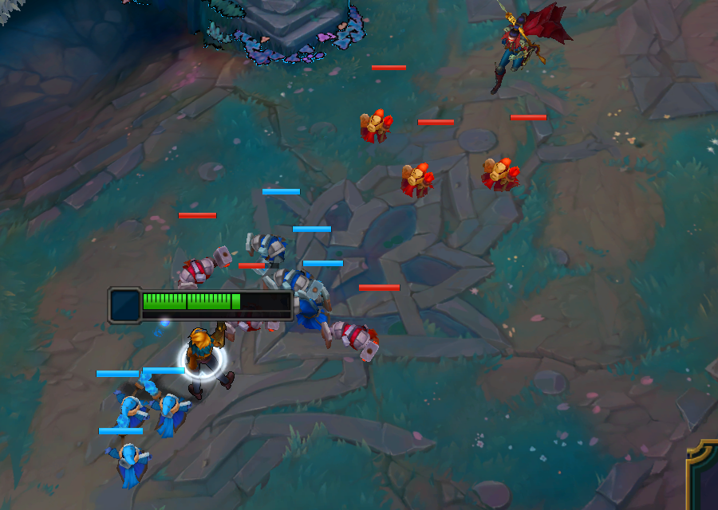

- **웨이브:** 웨이브를 소환하면 팀(블루/레드) × 라인(탑/미드/바텀)마다 근접 3 + 원거리 3마리가 0.5초 간격으로 순차 소환되고, 안내 텍스트와 효과음이 나옵니다.
- **이동:** 라인 좌표 데이터를 따라 이동하고, 라인 오프셋과 군집 회피(separation)를 더해 미니언끼리 겹치지 않고 퍼져서 이동합니다.
- **타겟 선택:** 적 미니언 → 플레이어 → 건물 → 적 챔피언 순으로 탐색하고, 사거리를 완전히 벗어나면 타겟을 해제합니다.
- **상태:** 대기 / 이동 / 추적 / 공격 / 사망을 상태 패턴으로 구현했고, 원거리 미니언은 투사체를 발사합니다.
- **풀링:** 미니언(팀·타입별 30마리), 체력바 UI를 오브젝트 풀링으로 재사용합니다. 사망하면 충돌·피킹 그룹에서 빠지고 풀로 반환됩니다.

## 4. 건물 / 승리 조건

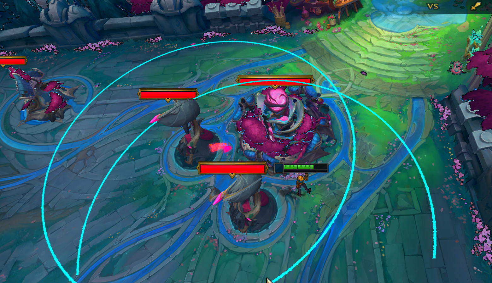 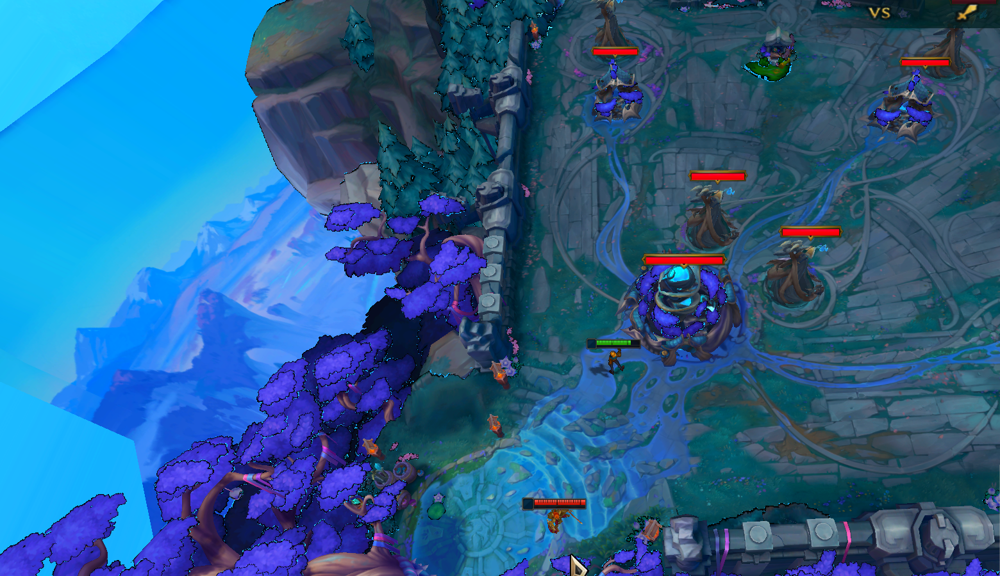

- **터렛:** 상대 팀 미니언을 먼저, 그다음 챔피언을 대상으로 고르고 사거리·쿨타임이 맞으면 투사체를 발사합니다. 레드 터렛은 플레이어가 가까워지면 **사거리 원이 거리에 따라 서서히 나타납니다.**
- **억제기 / 넥서스:** 건물 종류별로 체력바 크기와 높이를 다르게 적용했고, 건물은 파괴되어도 모델이 남습니다.
- **승리 연출:** 적 넥서스가 파괴되면 죽음 애니메이션과 폭발 이펙트가 재생되고, 월드 시간은 멈추지만 연출과 UI는 실시간으로 계속 진행되어 승리 UI와 사운드가 나옵니다.

## 5. UI

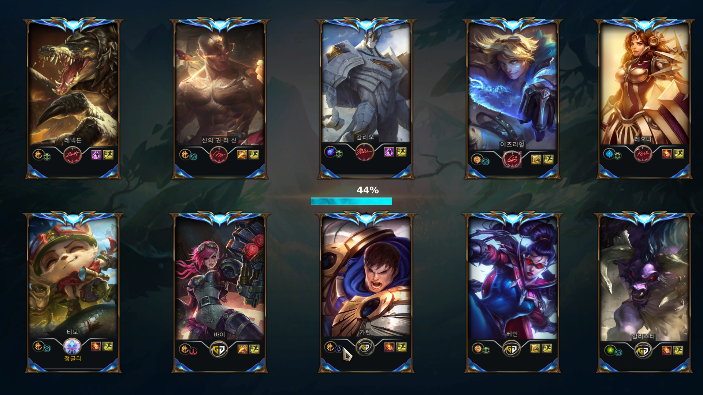 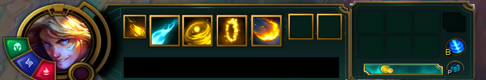

- **로딩 화면:** 챔피언 이미지, 로딩바, 진행 문구("텍스쳐 로딩 중", "원본 객체 로딩 중", "이펙트 로딩 중")를 표시합니다.
- **스킬바:** 스킬 아이콘 5개와 쿨타임을 표시하고, 챔피언을 교체하면 아이콘이 갱신됩니다. 경험치바에는 챔피언 아이콘이 함께 표시됩니다.
- **미니맵 / 게임 정보 / 아이템 정보** 패널을 구현했습니다.
- **체력바:** 플레이어, 적 챔피언, 미니언, 건물 4종이며 대상 위치를 따라다니고 크기는 대상 종류에 맞춰 달라집니다.
- **안내 텍스트:** 게임 시작 10초 뒤 환영 문구와 음성, 웨이브 소환 안내 문구를 띄웁니다.
- **커서:** 일반 / 공격 커서를 대상에 따라 전환하는 커스텀 커서를 구현했습니다.

## 6. 쉐이더, 빛 연산

### Deferred Shader

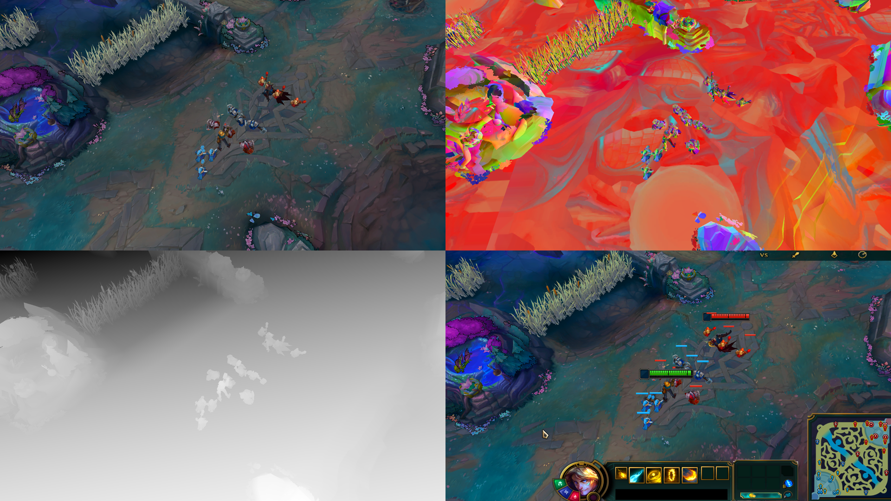

- 렌더 타겟을 여러 개 생성해 디퍼드 렌더링을 구현했습니다. **Diffuse, Normal, Depth, Shade, Specular**를 개별 타겟에 저장하고 조명 연산을 후처리 셰이더로 분리해, 광원 수가 늘어도 화면 해상도에 비례하는 고정 비용으로 처리합니다.
- 디렉셔널 라이트와 포인트 라이트를 지원하고, 깊이 타겟은 32비트 float로 두어 깊이로 월드 좌표를 정확히 복원합니다.
- 렌더 패스는 Priority → ShadowDepth → Deferred(NonAlphaBlend / Lights / Blend) → NonLight → EdgeDetection → AlphaBlend → Glow → Distortion → PostProcessing → UI 순서입니다.

### Shadow

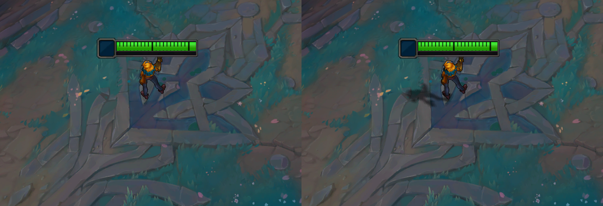

- 디렉셔널 라이트 기준 **그림자 맵**(8192×4608, float32)을 만들고, 최종 합성 단계에서 월드 좌표를 광원 공간으로 변환해 그림자를 판정합니다.
- 그림자 카메라가 **플레이어를 따라다니며** 선명도를 유지하고, 3×3 PCF로 가장자리를 부드럽게 처리했습니다.
- 발밑에는 부드러운 **접촉 그림자(블롭 섀도)** 를 추가했습니다.

### Outline (카툰 렌더링)

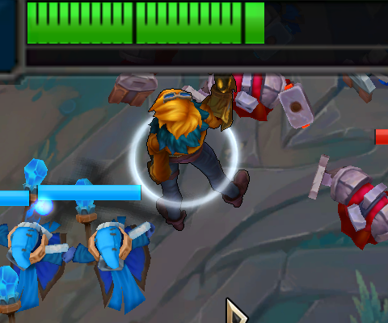

- 캐릭터의 실루엣을 별도 렌더 타겟에 그린 뒤, 이웃 픽셀의 알파 차이로 윤곽선을 검출해 검은 외곽선으로 블렌딩합니다. 카메라 거리에 따라 외곽선이 옅어집니다.

### Glow / Distortion

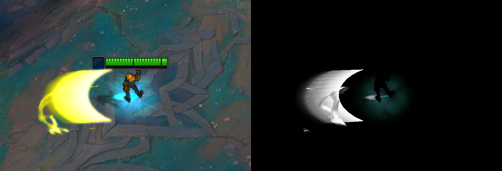

- **Glow:** 발광 오브젝트를 별도 타겟에 그린 뒤 17탭 가중치로 가로·세로 블러를 거쳐 원본 위에 합성합니다.
- **Distortion:** 왜곡 마스크 타겟과 노이즈 텍스처로 화면을 일그러뜨리는 효과를 구현했습니다.
- 두 효과는 이펙트 데이터의 옵션(글로우 / 디스토션 여부)으로 이펙트마다 켜고 끌 수 있습니다.

## 7. 프레임워크

### 오브젝트 / 레벨 / 풀링

- `Prototype → Clone` 패턴으로 오브젝트와 컴포넌트를 생성하고, 레벨·레이어 단위로 업데이트와 렌더 그룹을 관리합니다.
- **로딩 스레드:** 로딩 레벨에서 별도 스레드(크리티컬 섹션으로 보호)로 텍스처·프로토타입·이펙트를 미리 만들어 두어, 인게임에 진입한 뒤에는 로딩 없이 바로 진행됩니다.
- 미니언, 투사체, 체력바 UI, 이펙트는 **오브젝트 풀링**으로 재사용합니다.
- 참조 카운트로 수명을 관리하고, 수명이 끝난 오브젝트는 **묘지 목록에 두었다가 지연 해제**해 다른 오브젝트가 포인터를 잠시 들고 있어도 안전하게 정리됩니다.

### 카메라 / 입력 / 충돌

- **게임 카메라:** 플레이어를 부드럽게 따라가며(Lerp 보간) 기본 거리에서 마우스 휠로 줌 범위를 조절합니다. `F1`로 자유 이동하는 디버그 카메라로 전환합니다.
- 마우스 **레이 피킹**으로 지형과 대상을 선택합니다.
- 충돌은 그룹(플레이어 / 적 / 미니언 / 투사체 / 건물 / NPC)별로 처리합니다.
- 월드 시간과 UI 시간을 분리해, 게임 종료 연출 중에는 월드는 멈추고 UI만 갱신됩니다.

### 모델 / 애니메이션

- Assimp 데이터를 전용 바이너리로 **사전 직렬화**해 매번 원본 에셋을 파싱하는 병목을 없애고 로딩 속도와 메모리 효율을 높였습니다.
- **GPU 스키닝**과 키프레임 보간, 계층 구조 연산(`Invalidate_CombinedTransformationmatrix`)을 구현했고, 애니메이션 전환 시 포즈를 부드럽게 연결해 모델 뒤틀림과 끊김을 해결했습니다.
- 툴에서 지정하는 **애니메이션 이벤트**(특정 프레임에 동작 실행)를 지원하고, 챔피언이 이를 이용해 스킬 타이밍을 맞춥니다.

## 8. 네비게이션 (A* + Funnel)

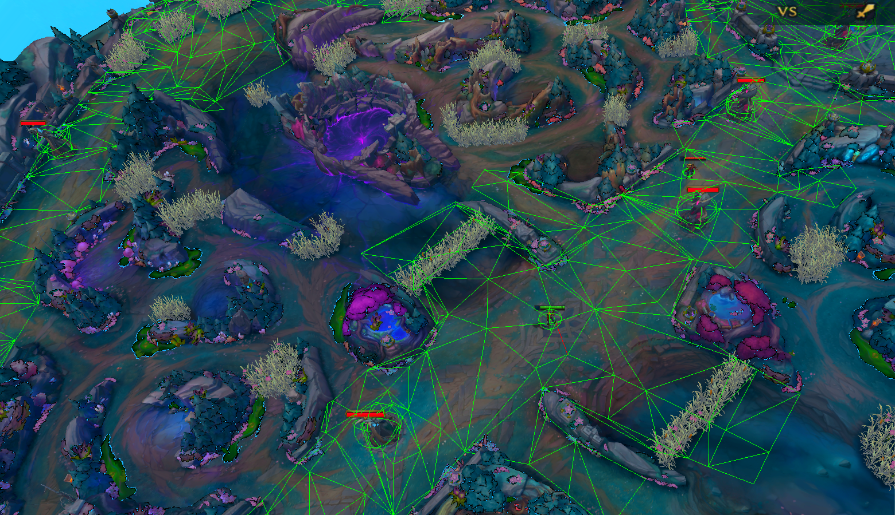

- 전체 셀을 전수 조사하지 않도록 **격자 기반 공간 분할**을 적용해 탐색 비용을 줄였습니다.
- `A*`로 셀 경로를 구한 뒤 `Funnel` 알고리즘의 포탈 판정으로 지그재그 경로를 매끄러운 최단 경로로 보정했습니다.
- 플레이어, 적 챔피언, 미니언이 같은 내비메시 위에서 이동하며, 지형 높이는 내비 셀에서 구해 적용합니다.

## 9. IMGUI

ImGui로 시각적으로 편리한 제작 툴을 만들었습니다. 탭 하나가 하나의 에디터입니다.

### Terrain Tool / Model Tool

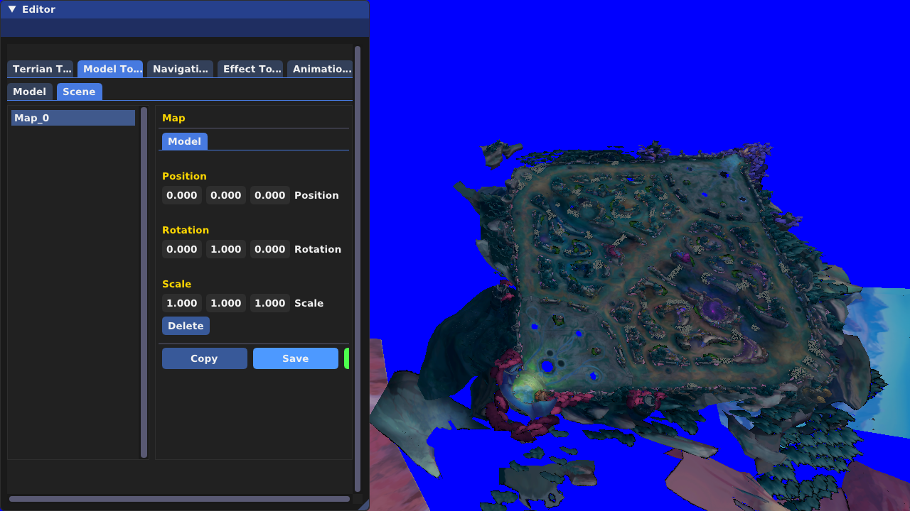

- 지형은 격자(NumX × NumZ) 크기와 위치·회전을 지정해 생성하고, 와이어프레임으로 확인하며 저장·불러오기를 지원합니다.
- 모델은 **레이어별로** 설치·복사·삭제하고, 마우스 피킹으로 선택해 기즈모(ImGuizmo)로 위치·회전·크기를 조절합니다. 설치한 데이터는 `.dat`로 저장해 게임이 그대로 읽습니다. (맵 배치, 건물·적·미니언 스폰 위치, 미니언 라인 좌표)

### Navigation Tool

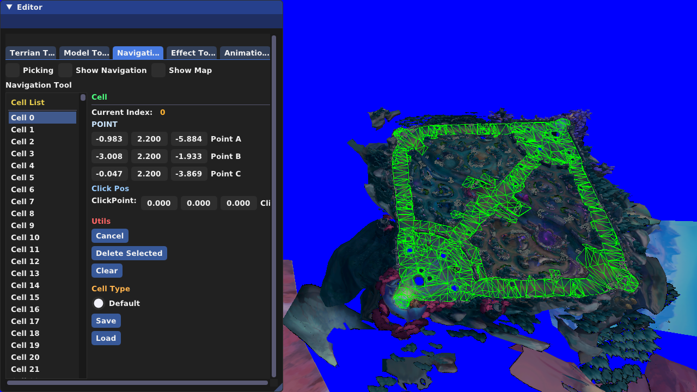

- 지형 메시를 피킹해 내비게이션 셀을 만들고, 셀 데이터를 저장·불러옵니다. 내비메시만 따로 표시해 확인할 수 있습니다.

### Effect Tool

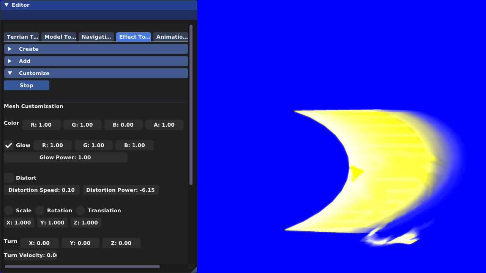

- 메시·텍스처·파티클 이펙트를 만들고, 색상·알파·크기·스케일·속도·회전·노이즈·디스토션을 **커브 에디터**에서 시간 구간별로 편집합니다.

### Animation Tool

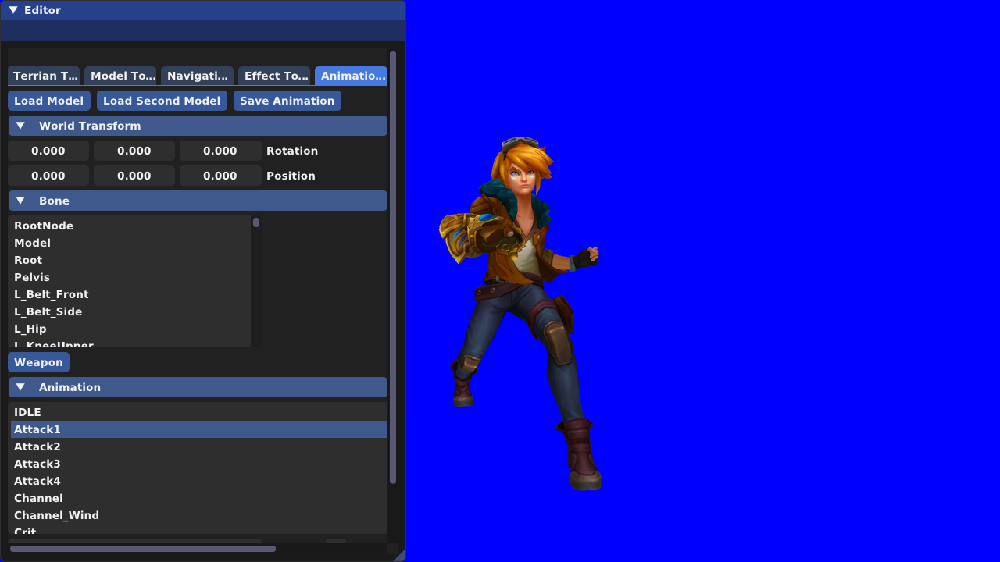

- 모델과 애니메이션을 불러와 확인하고, 본(Bone)을 선택해 **무기를 부착**하고, 애니메이션 구간을 편집하며, 특정 프레임에 **이벤트**를 추가합니다.

### FbxToDat

- FBX/GLB(애니메이션·논애니메이션·이펙트 메시)를 게임 전용 바이너리 `.dat`로 변환하는 별도 도구입니다.

# *기술적 요소*

- 프로토타입 패턴 / 레벨 제어 / 로딩 스레드 / 오브젝트 풀링
- 상태 패턴 / 상태이상 시스템 / 레이 피킹 / 충돌 그룹 / 타겟 우선순위 AI
- 디퍼드 렌더링(MRT) / 그림자 맵(PCF, 접촉 그림자) / 외곽선 / 글로우 / 디스토션
- Assimp 바이너리 직렬화 / GPU 스키닝 / 애니메이션 블렌딩 / 애니메이션 이벤트
- 네비메시 `A*` + `Funnel` / 격자 공간 분할
- 데이터 기반 이펙트(커브 보간) / FMOD 채널 관리
- ImGui 에디터(지형·모델·내비·이펙트·애니메이션) / FBX 변환 파이프라인
- 메모리 누수 진단과 수명 관리(묘지 지연 해제)
